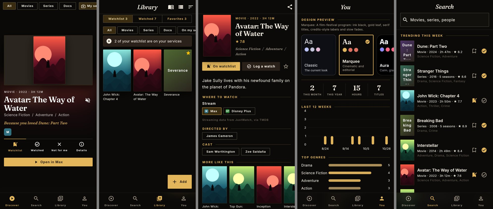
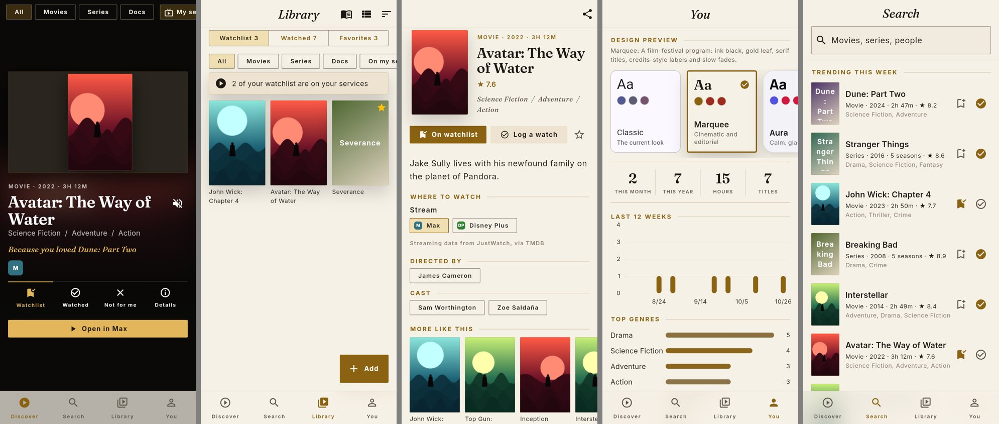
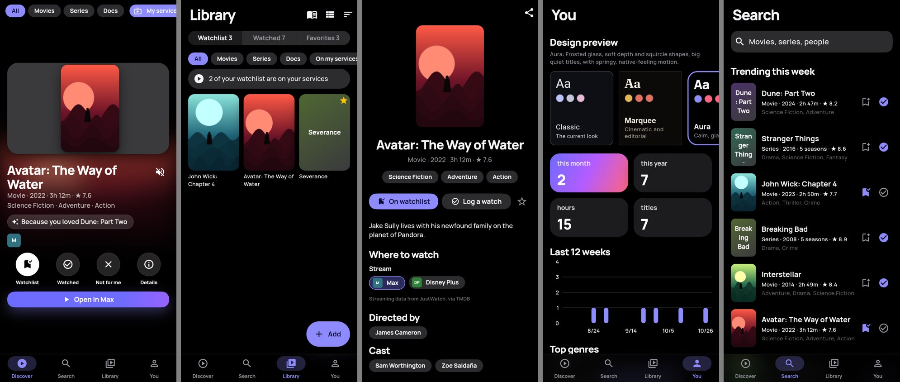
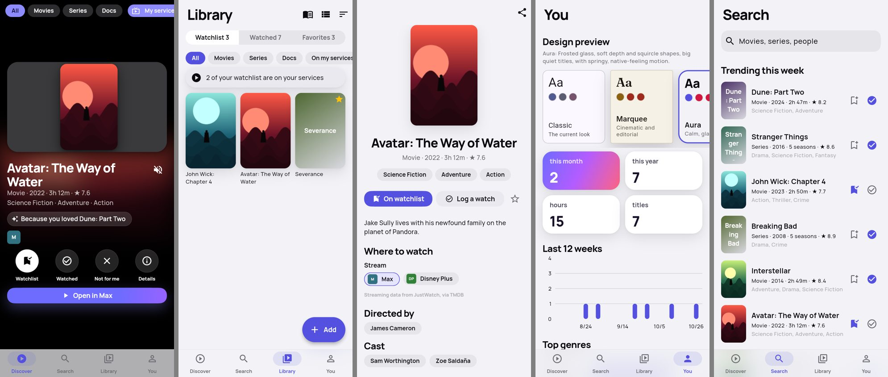
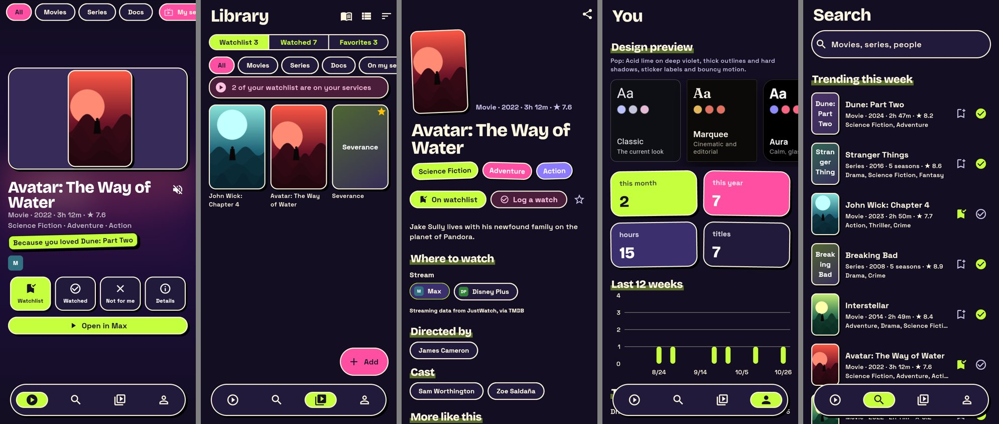
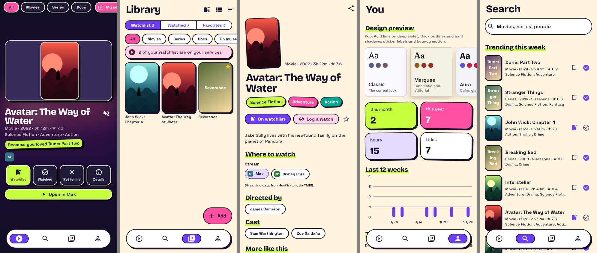
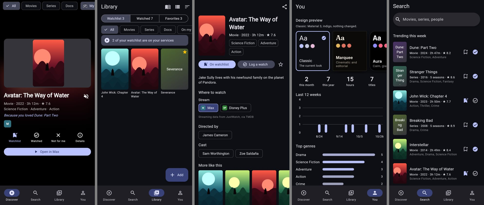

# Design directions

Three drafts of Reel's look, plus the original, switchable at runtime so they can be tried on a real phone before one is picked. Behavior, data and navigation are the same in all of them; only the presentation changes.

**Switching:** You tab, *Design preview*, tap a card. The whole app cross-fades into the new design and remembers it on the device. To start a build on a given design, add `--dart-define=REEL_DESIGN=marquee` (or `aura`, `pop`, `classic`); a design picked on the You tab wins over the define. Light and dark both work in every design (You tab, *Theme*). Discover stays dark in all of them.

Screens in each strip: Discover, Library, a title, You, Search. Posters in these shots are stand-in artwork; the real app shows TMDB images.

## Marquee: cinematic and editorial

A film-festival program. Ink black (warm paper in light mode), gold-leaf accent, oxblood as a second color.

- **Type:** Fraunces serif for titles (italic for the screen names and the "Because you loved…" line), Inter for text. Small labels are tracked capitals, like film credits ("MOVIE · 2022 · 3H 12M").
- **Shape:** square corners (2px), hairline rules and outlines instead of filled cards. Section headings are gold captions with a rule.
- **Layout:** stats read as a credits row between two gold rules; title pages are a program note (caption, serif title, rating, genres in italic).
- **Motion:** slow fades (fade-forward page transitions, 520ms ease-out). A frosted bottom bar with gold icons and no pill.

## Aura: calm, glassy, light

Native-feeling and quiet, in the spirit of the best iOS apps. Grouped grey backgrounds with white cards by day, true black at night; indigo accent with a pink-violet gradient for hero moments.

- **Type:** Manrope throughout, heavy and tightly tracked for large left-aligned titles.
- **Shape:** squircle corners (continuous curves), soft layered shadows, no outlines. iOS-style segmented control and green switches.
- **Layout:** title pages center a floating poster over the title; stats are tiles led by a gradient one; Discover's actions are frosted round buttons and the reason is a frosted pill.
- **Motion:** Cupertino page transitions, springy press feedback (buttons shrink to 95%), a full-width frosted tab bar.

## Pop: loud, graphic, playful

Neo-brutalist and fun. Acid lime and hot pink on deep violet (cream by day, with violet as the accent).

- **Type:** Bricolage Grotesque, extra bold, for titles; Space Grotesk for text. Section headings sit on a highlighter stroke.
- **Shape:** 2px outlines and hard offset shadows on posters, cards and buttons; pills everywhere; slightly tilted stickers for genres and the "Because you loved…" line.
- **Layout:** stats are colored sticker tiles; Discover's actions are chunky outlined blocks; the bottom bar is a floating pill with icons only.
- **Motion:** zoom page transitions, bouncy press feedback (92%, ease-out-back).

## Classic

The look before this change, unchanged, for comparison.

## How it's built

- `lib/core/theme/app_design.dart`: the `AppDesign` enum.
- `lib/core/theme/designs/`: one `ThemeData` builder per design (colors, type, component themes, page transitions).
- `lib/core/theme/reel_style.dart`: `ReelStyle`, a `ThemeExtension` for what Material has no slot for (poster and card corners, outlines, hard and soft shadows, highlight color, gradient, nav style, motion). Read it with `context.reel`.
- `lib/presentation/widgets/design_kit.dart`: pieces that differ per design (`SectionHeader`, `Eyebrow`, `ReelSurface`, `HeroButton`, `IconBadge`, `PressScale`). Screens use these instead of styling by hand.
- `appDesignProvider` (`account_providers.dart`) holds the choice, saved in shared preferences.
- Fonts are bundled in `assets/fonts/` (SIL Open Font License, see `OFL.md`), so they work offline and in tests.

Once a direction is picked, the other two can be deleted along with the picker; screens only read tokens and the design kit, so nothing else changes.
